# 🧠 SynapseReason: Autonomous Cross-Silo Reasoning & Incident Remediation Architecture
### Built for Open Agent Hackathon 2026 — Track 3: Reasoning Architecture (GenAI Works)

[](#)
[](#-the-2026-tri-protocol-stack-eliminating-linear-architectures)
[](SPONSORS.md#1-zetaris)
[](SPONSORS.md#2-meterless)
[](SPONSORS.md#3-nvidia)
[](SPONSORS.md#4-bright-data)
[](.cursorrules)
[](LICENSE)

---

## 📌 Executive Summary

Modern enterprise risk management, cybersecurity incident response, and financial forensics suffer from a critical failure mode: **linear, fragile agent pipelines**. When an alert fires (e.g. an unexpected spike in vendor disbursements), traditional agents follow a rigid sequence (`Planner -> Writer -> Summarizer`). When their initial hypothesis is wrong, they fail catastrophically or hallucinate without evidence verification.

### The Solution: SynapseReason
**SynapseReason** is an autonomous reasoning engine designed from the ground up for **Track 3: Reasoning Architecture**. Built on the **GenAI Works 2026 Tri-Protocol Stack (MCP + A2A + AG-UI)**, it turns fragmented data, episodic memory, and critical evaluation into reliable, cost-governed decisions:
1. **Non-Linear Reasoning Graph:** Dynamic **Planner <-> Executor <-> Evaluator/Critic** state machine with automated hypothesis branching, refutation, and backtracking.
2. **Tri-Protocol Foundation (MCP + A2A + AG-UI):** 
   - **MCP (Anthropic):** Universal port for tools & data (Zetaris Data Fabric & Bright Data).
   - **A2A (Google):** Inter-agent collaboration with cryptographic Signed Agent Cards.
   - **AG-UI (CopilotKit):** Live thought feed and Human-in-the-Loop (HITL) approval gates.
3. **Zero-Copy Data Virtualization (Zetaris):** Executes federated SQL joins across distributed enterprise silos (SAP ERP, AWS CloudTrail, Coupa Contracts) without data movement.
4. **Step-by-Step Cost & Token Governance (Meterless):** Real-time token metering, per-step cost attribution, and hard budget cap enforcement ($0.50 ceiling).
5. **Cognitive Backbone & Safety (NVIDIA NIM & NeMo):** Strategic multi-step reasoning via NVIDIA NIM paired with NeMo Guardrails for evidence grounding verification and action reversibility.
6. **Zero-Config Instant Evaluation:** Built-in `SAMPLE_MODE=true` enables judges to clone and run the full non-linear investigation in seconds without private API keys.

---

## 🌐 The 2026 Tri-Protocol Stack: Eliminating Linear Architectures

As highlighted by **GenAI Works** in October 2026, building cutting-edge agents requires mastering all three protocol layers:

```
┌────────────────────────────────────────────────────────────────────────┐
│             HUMAN DECISION MAKER / RISK OFFICER (Browser)              │
└───────────────────────────────────┬────────────────────────────────────┘
                                    │  [AG-UI Protocol Layer]
                                    │  (Live Thought Feed, Human-in-the-Loop Approvals)
                                    ▼
┌────────────────────────────────────────────────────────────────────────┐
│             SYNAPSEREASON COGNITIVE ORCHESTRATION ENGINE               │
│               Brain: NVIDIA NIM (Llama-3.1-70B / Nemotron)             │
│               Cost Governance: Meterless.io Real-Time Telemetry        │
└───────────────────┬────────────────────────────────┬───────────────────┘
                    │ [MCP Protocol Layer]           │ [A2A Protocol Layer]
                    │ (Universal Tool & Data Port)   │ (Signed Agent Cards)
                    ▼                                ▼
       ┌─────────────────────────┐      ┌─────────────────────────┐
       │   Enterprise Silos      │      │ Specialized Sub-Agents  │
       │ • Zetaris Data Fabric   │      │ • Forensics Planner     │
       │ • Bright Data OSINT     │      │ • NeMo Critic/Evaluator │
       │ • ERP & IAM Ledgers     │      │ • Data Fabric Agent     │
       └─────────────────────────┘      └─────────────────────────┘
```

| Protocol | Origin & Steward | Architectural Role in SynapseReason |
|---|---|---|
| **MCP (Model Context Protocol)** | Anthropic / Agentic AI Foundation | **Universal Tool & Data Port:** Wraps Zetaris Data Fabric (`mcp://zetaris/federated_sql`) and Bright Data (`mcp://brightdata/scrape_vendor`) in standardized JSON-RPC interfaces. |
| **A2A (Agent2Agent Protocol)** | Google / Agentic AI Foundation | **Inter-Agent Collaboration:** Employs v1.0 Signed Agent Cards with cryptographic fingerprints. When NeMo Critic refutes Hypothesis H1, it passes an authenticated A2A dispute message to Planner to trigger dynamic backtracking. |
| **AG-UI (Agent-User Interaction)** | CopilotKit / Google ADK / AWS | **Live Feed & Human-in-the-Loop:** Streams thought events to the UI and enforces mandatory human approval gates for irreversible actions (e.g. `$591,500` SWIFT wire recalls). |

---

## 🏛️ Cognitive Architecture & Reasoning Graph

```mermaid
flowchart TD
    classDef memory fill:#E0F2FE,stroke:#0284C7,stroke-width:2px;
    classDef planner fill:#DBEAFE,stroke:#2563EB,stroke-width:2px;
    classDef executor fill:#EDE9FE,stroke:#7C3AED,stroke-width:2px;
    classDef critic fill:#FEF3C7,stroke:#D97706,stroke-width:2px;
    classDef backtrack fill:#FEE2E2,stroke:#DC2626,stroke-width:2px;
    classDef gov fill:#DCFCE7,stroke:#16A34A,stroke-width:2px;

    Alert["🚨 Enterprise Incident Alert<br><b>INC-4491: High-Volume Disbursement Spike</b>"] --> Step1
    
    subgraph S1 ["Step 1: Context Seeding"]
        Step1["🧠 Episodic Memory Recall<br><i>Matches past precedent EP-2025-089</i>"]:::memory
    end
    
    subgraph S2 ["Step 2: Tree Formulation"]
        Step1 --> Step2["📋 Planner (NVIDIA NIM via A2A)<br>Formulate Competing Hypotheses Tree<br><b>H1: DB Sync Lag | H2: Session Hijack</b>"]:::planner
    end
    
    subgraph S3 ["Step 3: Null Hypothesis Execution"]
        Step2 -->|A2A Task Delegation| Step3["⚡ Executor: Zetaris Query via MCP<br><i>mcp://zetaris/federated_sql</i>"]:::executor
    end
    
    subgraph S4 ["Step 4: Critique & Backtracking"]
        Step3 --> Step4["🔍 NeMo Critic Agent (A2A Dispute)<br><b>H1 Refuted: 0ms CDC delay</b>"]:::critic
        Step4 -->|Branch Pruned| Step4B["↺ Dynamic Backtracking<br><b>Pivot to Hypothesis H2</b>"]:::backtrack
    end
    
    subgraph S5 ["Step 5: Deep Cross-Silo Correlation"]
        Step4B --> Step5["🌐 Zetaris 3-Silo Federated Join (MCP)<br><i>ERP ⨝ CloudTrail ⨝ Contracts</i>"]:::executor
        Step5 --> Step6["🌐 Bright Data External Intel (MCP)<br><i>Scrape Cyprus Company Registry: 89% Shell</i>"]:::executor
    end
    
    subgraph S6 ["Step 6: Evidence Verification"]
        Step6 --> Step7["🛡️ NVIDIA NeMo Guardrail<br><b>Grounding Score: 94% | Safety Verified</b>"]:::critic
    end
    
    subgraph S7 ["Step 7: Governance & HITL Approval"]
        Step7 --> Step8["⚡ Meterless Cost Audit<br><i>2,846 Tokens | $0.00824 Cost | 1.65% Budget</i>"]:::gov
        Step8 --> Action["✅ Verified Remediation Executed<br><b>Halted $443,000 ACH Outflow | AG-UI Signoff</b>"]:::gov
    end
```



---

## ⚡ Key Highlights for Judges (Track 3 Alignment)

| Track 3 Requirement | Traditional Linear Agent | SynapseReason Cognitive Architecture |
|---|---|---|
| **Pipeline Flow** | Fixed sequence (`Planner -> Writer`) | **Dynamic Planner <-> Executor <-> Evaluator state graph** |
| **Protocol Stack** | Monolithic closed scripts | **Tri-Protocol: MCP (Tools) + A2A (Agents) + AG-UI (Humans)** |
| **Error Handling** | Crashes or repeats failed prompt | **Dynamic Backtracking:** Refutes H1, prunes branch, pivots to H2 |
| **Memory System** | Ephemeral or single context window | **Dual Memory:** Active Working Scratchpad + Persistent Episodic Cases |
| **Data Access** | Requires copying data to central lake | **Zetaris Virtual Data Fabric:** Zero-copy cross-silo SQL federation |
| **Cost Control** | Unbounded loops, unmonitored spend | **Meterless Governance:** Real-time token burn and hard budget ceilings |
| **Verification & Safety** | Blind trust in LLM outputs | **NVIDIA NeMo Guardrails:** Grounding score (>85%) & action reversibility |
| **External Intel** | Blind to outside counterparty risk | **Bright Data:** Scrapes live registries to detect shell entities |

---

## 🚀 1-Click Quickstart (Judge Evaluation)

The repository comes pre-configured with **`SAMPLE_MODE=true`**, allowing you to test the complete cognitive reasoning loop, Zetaris queries, and Meterless billing **instantly without entering any API keys**.

### 1. Clone & Enter Repository
```bash
git clone https://github.com/your-username/synapse_reason.git
cd synapse_reason
```

### 2. Install Dependencies
```bash
pip install -r requirements.txt
```

### 3. Launch Interactive Web Dashboard
```bash
python -m streamlit run app.py
```
*Open your browser to `http://localhost:8501`. Click **"🚀 Run Non-Linear Reasoning Loop"** to explore the dynamic trace visualizer, Tri-Protocol inspector, Zetaris virtual query console, Meterless cost burn charts, and remediation action center.*

### 4. Or Run via Standalone Terminal CLI
```bash
python cli.py
```

---

## 🤝 Sponsor Technologies Integrated

Detailed documentation and code locations available in [**`SPONSORS.md`**](SPONSORS.md).

- **[Zetaris](https://zetaris.com)**: Powers zero-copy federated queries across 3 heterogeneous enterprise silos (`erp_transactions`, `cloud_audit_logs`, `vendor_contracts`). Implemented in [`core/zetaris_federator.py`](core/zetaris_federator.py).
- **[Meterless](https://meterless.io)**: Meters token consumption per reasoning step, tracks latency, and guarantees budget cap compliance. Implemented in [`core/meterless_governor.py`](core/meterless_governor.py).
- **[NVIDIA NIM & NeMo](https://developer.nvidia.com)**: Cognitive reasoning backbone (`meta/llama-3.1-70b-instruct`) and NeMo Guardrail evidence verification critic. Implemented in [`core/nvidia_engine.py`](core/nvidia_engine.py).
- **[Bright Data](https://brightdata.com)**: External web intelligence and corporate registry scraping for third-party counterparty risk. Implemented in [`core/brightdata_tool.py`](core/brightdata_tool.py).
- **[Cursor](https://cursor.com)**: Built and architected natively in Cursor using custom agent rules in [`.cursorrules`](.cursorrules).

---

## 📂 Project Structure

```
synapse_reason/
├── .cursorrules               # Cursor AI rules enforcing non-linear reasoning & protocols
├── .env.example               # Clean environment variable template
├── README.md                  # Flagship hackathon README with Mermaid diagram & scoring
├── SPONSORS.md                # Comprehensive Sponsor Technology Explanation
├── SLIDES.md                  # 8-Slide presentation deck script
├── DEMO_VIDEO_SCRIPT.md       # 2.5-minute video recording script
├── requirements.txt           # Minimal, conflict-free dependencies
├── config.py                  # Runtime configuration (SAMPLE_MODE & live keys)
├── app.py                     # Streamlit interactive dashboard & trace viewer
├── cli.py                     # Standalone CLI runner with UTF-8 safe logs
├── test_engine.py             # Rapid test verification script
├── data/                      # 3 enterprise silos + episodic memory
│   ├── erp_transactions.csv   # SAP S/4HANA financial disbursements
│   ├── cloud_audit_logs.json  # AWS CloudTrail & Okta authentication logs
│   ├── vendor_contracts.json  # Coupa procurement SLA limits & verified bank routing
│   └── episodic_memory.json   # Persistent historical incident case bank
└── core/                      # Cognitive engine modules
    ├── memory.py              # Working Memory scratchpad + Episodic Case Store
    ├── zetaris_federator.py   # Zetaris Data Virtualization & Federated SQL engine
    ├── meterless_governor.py  # Meterless real-time token, cost & budget governance
    ├── nvidia_engine.py       # NVIDIA NIM reasoning & NeMo Guardrails critic
    ├── brightdata_tool.py     # Bright Data external intelligence scraper
    ├── reasoning_engine.py    # Non-linear Planner <-> Executor <-> Evaluator graph
    └── protocols/             # The GenAI Works 2026 Tri-Protocol Stack
        ├── mcp_server.py      # Anthropic Model Context Protocol (MCP) tool registry
        ├── a2a_agent_cards.py # Google Agent2Agent (A2A) with Signed Agent Cards
        └── ag_ui_stream.py    # CopilotKit Agent-User Interaction Protocol (AG-UI)
```

---

## 🎯 Hackathon Judging Scorecard Alignment (100 Points)

- **Impact (30 pts):** Prevents catastrophic enterprise fraud. In our benchmark scenario, immediately froze **$443,000 USD** in fraudulent disbursements within 5 seconds, preventing unrecoverable SWIFT transfers.
- **Technical (20 pts):** Non-linear graph with dynamic hypothesis branching, branch refutation, backtracking, dual-layer memory, and the Tri-Protocol Stack (MCP + A2A + AG-UI).
- **Innovation (15 pts):** First reasoning architecture to synthesize data fabric virtualization (Zetaris) with real-time financial agent governance (Meterless) and Signed Agent Cards (A2A).
- **Demo (15 pts):** Interactive Streamlit dashboard with live trace inspection, Tri-Protocol cards, step-by-step cost breakdown, and 1-click execution.
- **Product & UX (10 pts):** Professional enterprise interface featuring clear status badges, expandable step details, and actionable containment orders.
- **Sponsor Tech (10 pts):** Native, deep architectural roles for Zetaris, Meterless, NVIDIA, Bright Data, and Cursor.

---

## ⚖️ License
MIT License. Created by Yuvan for Open Agent Hackathon 2026.
