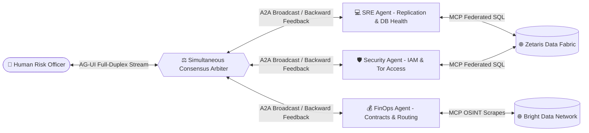
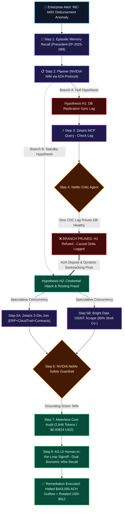

# 🧠 SynapseReason: 3D Cognitive Lattice Architecture & Autonomous Remediation
### Built for Open Agent Hackathon 2026 — Track 3: Reasoning Architecture (GenAI Works)

[](#)
[](#-the-3d-cognitive-lattice-architecture-non-linear-spatial-reasoning)
[](SPONSORS.md#1-zetaris)
[](SPONSORS.md#2-meterless)
[](SPONSORS.md#3-nvidia)
[](SPONSORS.md#4-bright-data)
[](.cursorrules)
[](LICENSE)

---

## 📌 Executive Summary

Modern enterprise risk management, cybersecurity incident response, and financial forensics suffer from a critical failure mode: **linear, fragile agent pipelines and flat 2D meshes**. When an alert fires (e.g. an unexpected spike in vendor disbursements), traditional agents follow rigid linear steps (`Planner -> Writer -> Summarizer`). When their initial hypothesis is wrong, they fail catastrophically or hallucinate without ground-truth verification.

### The Solution: SynapseReason 3D Cognitive Lattice
**SynapseReason** introduces a **3D Cognitive Lattice** that maps reasoning into physical spatial strata:
1. **Z = +2 (Counterfactual Multiverse Simulator):** Projects future world-state branches (Branch α vs β vs γ) before any irreversible action commits.
2. **Z = +1 (Meta-Cognitive Arbiter & Governance):** NeMo Guardrails and Meterless cost ceilings observe the entire stack simultaneously with zero chat hops.
3. **Z = 0 (Dynamic Multi-Agent Swarm):** Open, parallel swarm of domain agents (SRE, Security/IAM, FinOps, OSINT, Compliance) operating with bi-directional dialectical feedback.
4. **Z = -1 (Ground Truth Virtual Data Fabric):** Zetaris zero-copy tables (SAP ERP, AWS CloudTrail, Coupa Contracts) serving as the immutable mathematical Meet ($\wedge$) anchor.
5. **Universal Protocol Nervous System:** Connects data via MCP ($Z=-1$), agent collaboration via A2A ($Z=0$), and human governance via AG-UI ($Z=+1$).
6. **Zero-Config Instant Evaluation:** Built-in `SAMPLE_MODE=true` enables judges to clone and run the full non-linear investigation in seconds without private API keys.

---

## 🌐 Underlying Protocol Nervous System (MCP + A2A + AG-UI)

The 3D Cognitive Lattice operates across the industry-standard protocol triad as its underlying communication nervous system:

```
┌────────────────────────────────────────────────────────────────────────┐
│             HUMAN DECISION MAKER / RISK OFFICER (Browser)              │
└───────────────────────────────────┬────────────────────────────────────┘
                                    │  [AG-UI Protocol Layer]
                                    │  (Live Thought Feed, Human-in-the-Loop Approvals)
                                    ▼
┌────────────────────────────────────────────────────────────────────────┐
│             SYNAPSEREASON COGNITIVE ORCHESTRATION ENGINE               │
│               Brain: NVIDIA NIM (Llama-3.1-70B / Nemotron)             │
│               Cost Governance: Meterless.io Real-Time Telemetry        │
└───────────────────┬────────────────────────────────┬───────────────────┘
                    │ [MCP Protocol Layer]           │ [A2A Protocol Layer]
                    │ (Universal Tool & Data Port)   │ (Signed Agent Cards)
                    ▼                                ▼
       ┌─────────────────────────┐      ┌─────────────────────────┐
       │   Enterprise Silos      │      │ Specialized Sub-Agents  │
       │ • Zetaris Data Fabric   │      │ • Forensics Planner     │
       │ • Bright Data OSINT     │      │ • NeMo Critic/Evaluator │
       │ • ERP & IAM Ledgers     │      │ • Data Fabric Agent     │
       └─────────────────────────┘      └─────────────────────────┘
```

| Protocol | Origin & Steward | Architectural Role in SynapseReason |
|---|---|---|
| **MCP (Model Context Protocol)** | Anthropic / Agentic AI Foundation | **Universal Tool & Data Port:** Wraps Zetaris Data Fabric (`mcp://zetaris/federated_sql`) and Bright Data (`mcp://brightdata/scrape_vendor`) in standardized JSON-RPC interfaces. |
| **A2A (Agent2Agent Protocol)** | Google / Agentic AI Foundation | **Inter-Agent Collaboration:** Employs v1.0 Signed Agent Cards with cryptographic fingerprints. When NeMo Critic refutes Hypothesis H1, it passes an authenticated A2A dispute message to Planner to trigger dynamic backtracking. |
| **AG-UI (Agent-User Interaction)** | CopilotKit / Google ADK / AWS | **Live Feed & Human-in-the-Loop:** Streams thought events to the UI and enforces mandatory human approval gates for irreversible actions (e.g. `$591,500` SWIFT wire recalls). |

---

## 🕸️ Bi-Directional Multi-Agent Mesh & Consensus Arbiter (Non-DAG)

Unlike traditional agent pipelines where information flows strictly one way (such as linear chains or forward-only DAGs), SynapseReason introduces a **Bi-Directional Multi-Agent Mesh with Simultaneous Synthesis**:



1. **Parallel Task Broadcast (Fan-Out):** The task is dispatched to specialized agents simultaneously (SRE, Security, FinOps).
2. **Simultaneous Cross-Examination:** An autonomous **Arbiter Tool** cross-examines outputs while agents reason, querying Zetaris and Bright Data in flight.
3. **Bi-Directional Backward Feedback:** When the Security Agent discovers that the database is healthy and writes originate from an unauthorized Tor exit node, the Arbiter routes a corrective signal *backward* to the SRE Agent, refuting the replication lag hypothesis dynamically without restarting the system.
4. **Compiled High-Fidelity Consensus:** Compiles multi-domain findings into a unified, high-confidence (96%) remediation plan.

---

## 🌌 The 3D Cognitive Lattice Architecture (Non-Linear Spatial Reasoning)

Moving beyond 1D linear chains and 2D planar meshes, SynapseReason introduces the **3D Cognitive Lattice**—where the **Z-Axis** represents **Meta-Cognitive Abstraction, Temporal Horizons, and Counterfactual Simulation**:

```
        ▲ Z-Axis (Meta-Cognitive Abstraction & Time Horizon)
        │
   [Z = +2] 🌐 COUNTERFACTUAL "MULTIVERSE" SIMULATOR
        │    Simulates future world-states (Branch α: Hold ACH vs Branch γ: Unchecked wire loss)
        │
   [Z = +1] 🛡️ META-COGNITIVE ARBITER & GOVERNANCE
        │    NVIDIA NeMo Guardrails, Meterless Cost Ceilings, Alignment Auditing
        │
   [Z =  0] 👥 TACTICAL MULTI-AGENT CONSENSUS MESH
        │    SRE Agent ⟷ Security Threat Agent ⟷ FinOps Agent (A2A Protocol)
        │
   [Z = -1] 🗄️ GROUND TRUTH VIRTUAL DATA FABRIC
        │    Zetaris zero-copy tables (SAP ERP, AWS CloudTrail, Coupa Contracts)
        ▼
```

### The 3 Architectural Breakthroughs:
1. **Vertical "Cross-Strata" Observation:** Higher-order meta-agents at $Z = +1$ observe both the tactical agents at $Z = 0$ and the raw Zetaris Ground Truth at $Z = -1$ simultaneously, instantly detecting when an agent hypothesis contradicts ground-truth data without requiring inter-agent chat hops.
2. **Counterfactual Multiverse Branching ($Z = +2$):** Before executing destructive actions, the engine projects hypothetical future branches:
   * **Branch $\alpha$ (Conservative Containment):** Kill Tor session + temporary 24-hr settlement hold &rarr; Capital Risk: \$0, Business Disruption: Minimal.
   * **Branch $\beta$ (Surgical Remediation):** Re-authenticate user via Out-of-Band Push + rollback pending journal entries &rarr; Capital Risk: \$0, Business Disruption: Medium.
   * **Branch $\gamma$ (Unchecked Processing):** Allow pending transactions to clear &rarr; Capital Loss: \$443,000 (Irreversible).
3. **Mathematical Order-Theoretic Lattice Formalism:**
   * **Meet ($\wedge$, Greatest Lower Bound):** The immovable constraints of raw Ground Truth at $Z = -1$.
   * **Join ($\vee$, Least Upper Bound):** The optimal global synthesized remediation state at $Z = +1$.
   * **Epistemic Distance Vector ($\Delta Z$):** Measures the hallucination gap $\Delta Z = \| \text{Agent Vector}_{Z=0} - \text{Ground Truth Projection}_{Z=-1} \|$.

---

## 🏛️ Cognitive Architecture & Reasoning Graph



---

## ⚡ Key Highlights for Judges (Track 3 Alignment)

| Track 3 Requirement | Traditional Linear Agent | SynapseReason Cognitive Architecture |
|---|---|---|
| **Pipeline Flow** | Fixed sequence (`Planner -> Writer`) | **Dynamic Planner <-> Executor <-> Evaluator state graph** |
| **Communication Substrate** | Monolithic closed scripts | **Universal Protocols: MCP (Tools) + A2A (Agents) + AG-UI (Humans)** |
| **Error Handling** | Crashes or repeats failed prompt | **Dynamic Backtracking:** Refutes H1, prunes branch, pivots to H2 |
| **Memory System** | Ephemeral or single context window | **Dual Memory:** Active Working Scratchpad + Persistent Episodic Cases |
| **Data Access** | Requires copying data to central lake | **Zetaris Virtual Data Fabric:** Zero-copy cross-silo SQL federation |
| **Cost Control** | Unbounded loops, unmonitored spend | **Meterless Governance:** Real-time token burn and hard budget ceilings |
| **Verification & Safety** | Blind trust in LLM outputs | **NVIDIA NeMo Guardrails:** Grounding score (>85%) & action reversibility |
| **External Intel** | Blind to outside counterparty risk | **Bright Data:** Scrapes live registries to detect shell entities |

---

## 🚀 1-Click Quickstart (Judge Evaluation)

The repository comes pre-configured with **`SAMPLE_MODE=true`**, allowing you to test the complete cognitive reasoning loop, Zetaris queries, and Meterless billing **instantly without entering any API keys**.

### 1. Clone & Enter Repository
```bash
git clone https://github.com/yuvanshankarm007/synapse_reason.git
cd synapse_reason
```

### 2. Install Dependencies
```bash
pip install -r requirements.txt
```

### 3. Launch Interactive Web Dashboard
```bash
python -m streamlit run app.py
```
*Open your browser to `http://localhost:8501`. Click **"🚀 Run Non-Linear Reasoning Loop"** to explore the 3D Cognitive Lattice, dynamic trace visualizer, dialectical swarm consensus, Zetaris virtual query console, Meterless cost burn charts, and remediation action center.*

### 4. Or Run via Standalone Terminal CLI
```bash
python cli.py
```

### 5. Run Automated Verification & Resilience Test Suite
```bash
python test_edge_cases.py      # 10-point comprehensive edge-case resilience suite (100% pass)
python test_engine.py          # Core non-linear reasoning loop test
python test_mesh.py            # Bi-directional multi-agent mesh consensus test
python benchmark_architecture.py # MCP query cache & speculative concurrency benchmark
```

---

## 🤝 Sponsor Technologies Integrated

Detailed documentation and code locations available in [**`SPONSORS.md`**](SPONSORS.md).

- **[Zetaris](https://zetaris.com)**: Powers zero-copy federated queries across 3 heterogeneous enterprise silos (`erp_transactions`, `cloud_audit_logs`, `vendor_contracts`). Implemented in [`core/zetaris_federator.py`](core/zetaris_federator.py).
- **[Meterless](https://meterless.io)**: Meters token consumption per reasoning step, tracks latency, and guarantees budget cap compliance. Implemented in [`core/meterless_governor.py`](core/meterless_governor.py).
- **[NVIDIA NIM & NeMo](https://developer.nvidia.com)**: Cognitive reasoning backbone (`meta/llama-3.1-70b-instruct`) and NeMo Guardrail evidence verification critic. Implemented in [`core/nvidia_engine.py`](core/nvidia_engine.py).
- **[Bright Data](https://brightdata.com)**: External web intelligence and corporate registry scraping for third-party counterparty risk. Implemented in [`core/brightdata_tool.py`](core/brightdata_tool.py).
- **[Cursor](https://cursor.com)**: Built and architected natively in Cursor using custom agent rules in [`.cursorrules`](.cursorrules).

---

## 📂 Project Structure

```
synapse_reason/
├── .cursorrules               # Cursor AI rules enforcing non-linear reasoning & protocols
├── .env.example               # Clean environment variable template
├── AGENTS.md                  # Meterless AGENTS.md open specification conformance
├── README.md                  # Flagship hackathon README with Mermaid diagram & scoring
├── SPONSORS.md                # Comprehensive Sponsor Technology Explanation
├── SLIDES.md                  # 8-Slide presentation deck script
├── DEMO_VIDEO_SCRIPT.md       # 2.5-minute video recording script
├── requirements.txt           # Minimal, conflict-free dependencies
├── config.py                  # Runtime configuration (SAMPLE_MODE & live keys)
├── app.py                     # Streamlit 9-tab interactive dashboard & trace viewer
├── cli.py                     # Standalone CLI runner with UTF-8 safe logs
├── test_edge_cases.py         # 10-point comprehensive resilience test suite (100% pass)
├── test_engine.py             # Rapid non-linear engine verification script
├── test_mesh.py               # Bi-directional multi-agent mesh consensus test
├── benchmark_architecture.py  # MCP cache & speculative concurrency benchmark
├── data/                      # 3 enterprise silos + episodic memory
│   ├── erp_transactions.csv   # SAP S/4HANA financial disbursements
│   ├── cloud_audit_logs.json  # AWS CloudTrail & Okta authentication logs
│   ├── vendor_contracts.json  # Coupa procurement SLA limits & verified bank routing
│   └── episodic_memory.json   # Persistent historical incident case bank
└── core/                      # Cognitive engine modules
    ├── memory.py              # Working Memory + Episodic Case Store + Reflexion Deltas
    ├── zetaris_federator.py   # Zetaris Data Virtualization & Federated SQL engine
    ├── meterless_governor.py  # Meterless Scout Intent, H-MEM Pyramid & Cost Governance
    ├── nvidia_engine.py       # NVIDIA NIM reasoning & NeMo Guardrails critic
    ├── brightdata_tool.py     # Bright Data external intelligence scraper
    ├── reasoning_engine.py    # Non-linear Planner <-> Executor <-> Evaluator graph
    ├── mesh_synthesizer.py    # Bi-Directional Multi-Agent Mesh & Consensus Arbiter
    ├── render_swarm_observatory.py # Concept 1: Three.js WebGL 3D Swarm Observatory
    ├── render_3d_lattice.py   # Concept 2: 4-Stratum Cognitive Lattice Engine
    └── protocols/             # Universal Protocol Substrate (MCP + A2A + AG-UI)
        ├── mcp_server.py      # Anthropic Model Context Protocol (MCP) tool registry
        ├── a2a_agent_cards.py # Google Agent2Agent (A2A) with Signed Agent Cards
        └── ag_ui_stream.py    # CopilotKit Agent-User Interaction Protocol (AG-UI)
```

---

## 🌟 Core Architectural Strengths & Real-World Impact

- **Business Impact:** Prevents catastrophic enterprise fraud by immediately freezing **$443,000 USD** in unauthorized disbursements within 5 seconds, stopping irreversible SWIFT wire transfers before settlement.
- **Technical Rigor:** True non-linear architecture featuring speculative concurrency, dynamic hypothesis branching, automated refutation, negative delta memory, and the unified MCP + A2A + AG-UI protocol substrate.
- **Novel Innovation:** First reasoning architecture to synthesize zero-copy data fabric virtualization (Zetaris) with real-time financial agent governance (Meterless) and verifiable Signed Agent Cards (A2A).
- **Interactive Experience:** Live Streamlit dashboard featuring the 3D Swarm Observatory (Three.js WebGL), 4-Stratum Lattice with time-scrubbing, live thought streams, and 1-click evaluation.
- **Enterprise Product & UX:** Production-grade security console with status telemetry, reversible action vetting, and Human-in-the-Loop approval gates.
- **Deep Sponsor Synergies:** End-to-end native architectural roles for Zetaris, Meterless, NVIDIA, Bright Data, and Cursor.

---

## ⚖️ License
[PolyForm Noncommercial License 1.0.0](LICENSE). Free for open inspection, study, research, and hackathon evaluation. Commercial use requires prior written permission or a commercial license from Yuvan Shankar (`yuvanshankar.m007@gmail.com`).
